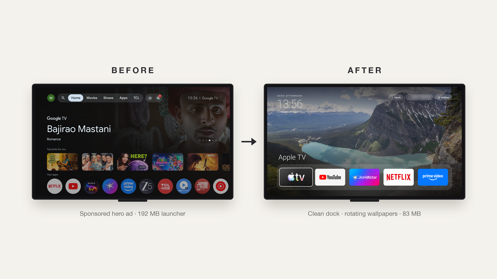

# tv-home

**Make a slow, ad-filled Android TV fast and clean again.** Debloat it over Wi-Fi and give it a
tiny glass-style home screen: frosted app panel on the left, clock top-left, quick buttons top-right,
rotating nature wallpapers behind it. You can hand the whole thing to Claude Code with one prompt, or do
it by hand with the scripts here.



On a 2 GB TCL Google TV (the original version of this launcher) this disabled 25 bloat apps and cut the home
screen's memory use from 192 MB to 83 MB. Everything is reversible: packages are disabled, never uninstalled.

## The launcher (v2, glass sidebar)

- **Left panel**: frosted glass (the wallpaper behind it, blurred) with your pinned apps. A highlight pill
  glides to the focused app and glows in that app's colour. The last entry, **Apps**, opens the full list.
- **Top-left**: clock with AM/PM and the date. **Top-right**: Wi-Fi, Bluetooth and Settings buttons
  (the Wi-Fi icon dims when there is no network).
- **Apps list**: every launchable app in a grid, including sideloaded phone apps that have no TV entry.
  Back (or Home) closes it.
- 12 nature photos crossfade every 10 minutes. Swap them in `launcher/assets/wallpapers/`
  (1920×1080 JPEGs, credits in `launcher/WALLPAPER-CREDITS.md`).
- Plain Android views, no AndroidX, **no network permission**, no background services.
- Sizes are in "design units" (540 units = screen height), so it looks the same on 1080p and 4K.

Edit `launcher/res/values/config.xml` to change the pinned apps (up to 6), hidden apps, the Apps-list columns and
the glass tint. Then rebuild (below).

## Setting up a Google TV on Android 11 or newer (Realme 4K TV Stick, Chromecast with Google TV, ...)

**1. On the TV:** Settings → System → About → press OK on **Build** 7 times → back → Developer options →
turn on **USB debugging** and **Wireless debugging**. Keep the TV on, on the same Wi-Fi as your computer.

**2. On your computer:** install [Android platform-tools](https://developer.android.com/tools/releases/platform-tools)
(`adb`). Android 11+ pairs first:

```bash
# TV: Developer options → Wireless debugging → "Pair device with pairing code" shows an IP:port and a 6-digit code
adb pair 192.168.1.50:41234          # enter the code when asked
# TV: the main Wireless debugging screen shows "IP address & port" (a different port)
adb connect 192.168.1.50:37123
adb devices                          # should list the TV as "device"
```

If `adb connect <tv-ip>:5555` already works with USB debugging on, you can skip pairing.

**3. Get the APK.** Either let GitHub build it, or build it yourself:

- *GitHub:* push this repo to your GitHub account → Actions → **Build APK** → open the latest run → download
  the `tvhome-apk` artifact and unzip it to get `tvhome.apk`.
- *Locally:* JDK 17, Android SDK platform 34 and build-tools 34.0.0 (`ANDROID_HOME` set), then
  `launcher/build-and-install.sh --adb` builds, installs and sets it as home in one go. Skip step 4.

**4. Preview it first, then make it the home screen.**

```bash
adb install -r tvhome.apk
adb shell am start -n com.mihir.tvhome/.MainActivity      # opens it on the TV; the stock home is untouched
```

If it looks right, make it permanent (Google TV's stock launcher and setup app are disabled, not removed):

```bash
adb shell cmd package set-home-activity --user 0 com.mihir.tvhome/.MainActivity
adb shell pm disable-user --user 0 com.google.android.apps.tv.launcherx
adb shell pm disable-user --user 0 com.google.android.tungsten.setupwraith
adb shell cmd package set-home-activity --user 0 com.mihir.tvhome/.MainActivity
adb shell input keyevent KEYCODE_HOME
```

**Undo it any time:**

```bash
adb shell pm enable com.google.android.apps.tv.launcherx
adb shell pm enable com.google.android.tungsten.setupwraith
adb shell cmd package set-home-activity --user 0 com.google.android.apps.tv.launcherx/.home.HomeActivity
adb shell input keyevent KEYCODE_HOME
```

`INSTALL_FAILED_UPDATE_INCOMPATIBLE` means an APK signed with a different key is installed:
`adb uninstall com.mihir.tvhome`, then install again.

**5. Debloat (optional).** Make a list from your own device, see [examples/realme-4k-tv-stick](examples/realme-4k-tv-stick/),
then `tools/disable-adb.sh <list>`. Undo with `tools/restore-adb.sh <list>`.

## Do it with Claude Code

1. On the TV, turn on **USB debugging** (and **Wireless debugging** on Android 11+).
2. Clone this repo, open Claude Code inside it (so it can reuse the launcher and scripts), and paste
   [PROMPT.md](PROMPT.md). On Android 11+ tell it to use native `adb pair` / `adb connect` and `tools/*-adb.sh`,
   because the bundled Python client only speaks the old port-5555 protocol.

## Older Android TV (macOS, Python client)

```bash
./setup.sh                                                  # Python ADB client, JDK 17, Android SDK
tools/find-tv.sh                                            # finds the TV, saves its IP
tools/venv/bin/python -I tools/tv.py --probe                # model, Android version
tools/disable.sh examples/tcl-google-tv-g07/debloat.txt     # or your own list, see examples/
launcher/build-and-install.sh                               # build + install the launcher
```

Undo everything with `tools/restore.sh <the same list>`.

## What's here

| Path | What it is |
|---|---|
| [PROMPT.md](PROMPT.md) | The prompt for Claude Code / any coding agent |
| [launcher/](launcher/) | The home screen. Plain Android, no network, no background services |
| [launcher/res/values/config.xml](launcher/res/values/config.xml) | Pinned apps, hidden apps, list columns, glass tint |
| [launcher/build-and-install.sh](launcher/build-and-install.sh) | Build the APK (`--build`), or build + install (`--adb` for native adb) |
| [.github/workflows/build-apk.yml](.github/workflows/build-apk.yml) | Builds the APK on GitHub, no local Android SDK needed |
| [tools/tv.py](tools/tv.py) | Pure-Python ADB client (old port-5555 protocol): shell, batch, screenshots, chunked APK push |
| [tools/find-tv.sh](tools/find-tv.sh) | Finds Android TVs on your Wi-Fi |
| [tools/type.sh](tools/type.sh) | Type into the TV's on-screen keyboard from your laptop |
| [tools/disable.sh](tools/disable.sh), [tools/restore.sh](tools/restore.sh) | Apply / undo a debloat list (Python client) |
| [tools/disable-adb.sh](tools/disable-adb.sh), [tools/restore-adb.sh](tools/restore-adb.sh) | Same, with native `adb` |
| [examples/](examples/) | Debloat lists per TV model |

## Gotchas we hit

- **Android 11+ Wireless debugging needs pairing** (`adb pair`) and uses a random port. The bundled Python client
  only connects to the old port 5555, so use native `adb` and the `*-adb.sh` scripts there.
- **macOS blocks the `adb` binary** on the local network ("No route to host"). `tools/tv.py` uses
  the `adb-shell` Python package instead (port-5555 TVs only).
- **Google TV hijacks the Home button.** With the stock launcher disabled, the setup app
  (`com.google.android.tungsten.setupwraith`) has a higher HOME priority than any third-party
  launcher. The install script disables it; the restore scripts re-enable it.
- **Home opened the launcher behind the current app**, because of a stale home task from switching
  launchers. Force-stopping the launcher and `com.android.tv.settings` and pressing Home fixes it.
  The install script does this.
- **Chained `pm` commands** (`pm disable a; pm disable b`) can silently stop after the first. The
  scripts run one per shell call.
- **Apps installed from the Play Store didn't appear**, because the package broadcast was missed
  while another app was in front. The launcher re-checks with `getChangedPackages` on every return.
- **Unsplash blocks scripted downloads** with a bot check. The wallpapers come from Wikimedia
  Commons Featured Pictures instead.

## Supported TVs

Android TV and Google TV: TCL, Xiaomi/Redmi, Hisense, Sony, OnePlus, Realme, Nvidia Shield,
Chromecast with Google TV and most others. Not Samsung (Tizen), LG (webOS) or Fire TV.
Tested on: TCL Google TV (Android 11). The v2 glass layout is not yet tested on a real TV: report what you see.

## Credits

Inspired by [Gathin23/tv-vibehack](https://github.com/Gathin23/tv-vibehack). Wallpaper photos are
from Wikimedia Commons under their own licences, see
[launcher/WALLPAPER-CREDITS.md](launcher/WALLPAPER-CREDITS.md). The wifi, bluetooth and settings icons are
Material Design icons (Apache License 2.0). Code is MIT, see [LICENSE](LICENSE).
